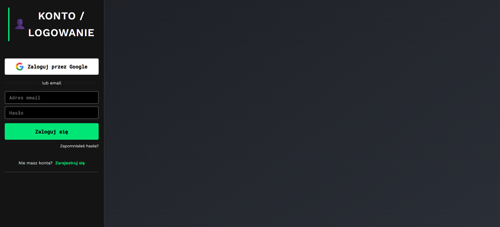
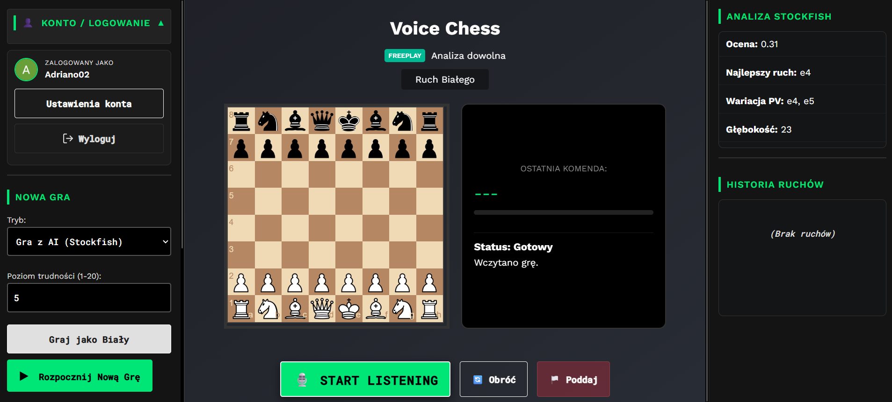
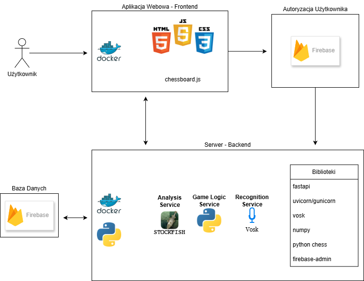

# Zarządzanie jakością systemu VChess

## Strona tytułowa

**Temat:** Zarządzanie jakością aplikacji szachowej VChess 
**Autor:** Adrian Nowowiejski

## 1. Opis systemu lub funkcji

### 1.1. Przedmiot projektu

Przedmiotem projektu jest ocena i zaplanowanie jakości systemu VChess - aplikacji umożliwiającej rozgrywanie partii szachowych w przeglądarce, w tym wydawanie poleceń głosowych w języku polskim. System składa się z interfejsu webowego oraz współpracujących usług backendowych uruchamianych w kontenerach Docker.

Zakres niniejszego opracowania obejmuje przede wszystkim jakość obsługi partii i głosowego wykonywania ruchów: od nagrania polecenia, przez rozpoznanie i interpretację, do zatwierdzenia oraz wykonania legalnego ruchu. Dodatkowe funkcje objęte opisem to gra z komputerowym przeciwnikiem, analiza pozycji i przechowywanie danych partii.

**Środowisko oceny:**
- Windows 11
- Przeglądarka Brave
- Aplikacja uruchamiana jest w kontenerach Docker

### 1.2. Cel systemu

Celem VChess jest umożliwienie użytkownikowi rozgrywania partii szachowej z użyciem interfejsu przeglądarkowego oraz poleceń głosowych. System ma rozpoznać wypowiedziane polecenie, powiązać je z ruchem możliwym w aktualnej pozycji i pozwolić użytkownikowi potwierdzić albo odrzucić proponowany ruch. Dzięki temu użytkownik może obsługiwać rozgrywkę bez konieczności ręcznego wybierania pól na planszy.

Aplikacja udostępnia ponadto tryb freeplay, tryb gry z AI, historię partii oraz analizę pozycji za pomocą silnika Stockfish.

**Cel jakościowy projektu:** 
- Ocena jakości logiki jednostek systemu
- Ocena jakości integracji systemu
- Ocena jakości doświadczeń użytkownika aplikacji 
- Zdiagnozowanie potencjalnych problemów i defektów projektu
- Ocena jakości dostępności dla osób ze wskazanymi niepełnosprawnościami motorycznymi

### 1.3. Główni użytkownicy i interesariusze

| Użytkownik / interesariusz | Potrzeby i oczekiwania |
|---|---|
| Gracz | Czytelna plansza, poprawne wykonywanie ruchów, informacja o stanie partii, intuicyjne sterowanie i kontrola nad aplikacją, możliwość wygodnego korzystania wyłącznie przy użyciu interfejsu głosowego, dobra jakość rozpoznawania poleceń w różnych warunkach otoczenia |
| Osoba oceniająca projekt | Jasno zdefiniowane wymagania jakościowe, kryteria akceptacji, ryzyka i dowody z testów. |
| Autor / osoba utrzymująca system | Możliwość modularnego uruchomienia usług, diagnozowania błędów i rozwijania aplikacji, możliwość 'prostego' wdrożenia produkcyjnego aplikacji |

### 1.4. Podstawowy sposób działania

1. Użytkownik uruchamia aplikację webową, loguje się na swoje konto i rozpoczyna nową partię lub wybiera dostępną nieukończoną partię.

2. Wybiera tryb gry: swobodną rozgrywkę między ludźmi albo rozgrywkę z AI. W trybie AI może grać białymi lub czarnymi.
3. Użytkownik zezwala przeglądarce na dostęp do mikrofonu i wypowiada ruch. Frontend przesyła nagranie do usługi rozpoznawania mowy Vosk.

4. Rozpoznany tekst trafia do usługi gry. Parser interpretuje polecenie w kontekście bieżącej pozycji i sprawdza możliwe ruchy.
5. Jeśli system dopasuje jeden ruch, pokazuje go do potwierdzenia. Jeśli polecenie jest niejednoznaczne lub nie pasuje do legalnego ruchu, informuje o tym użytkownika i nie wykonuje ruchu.
6. Po potwierdzeniu backend wykonuje ruch, aktualizuje pozycję i historię partii. Zakończenie partii jest sygnalizowane w interfejsie.
7. W trybie AI ruch przeciwnika wyznacza silnik Stockfish. W trybie swobodnym dostępna jest analiza pozycji.

### 1.5. Granice systemu i założenia

**W zakresie projektu:** interfejs przeglądarkowy, obsługa partii, rozpoznawanie i interpretowanie poleceń głosowych, walidacja legalności ruchu, potwierdzanie ruchu, tryb AI, konta i logowanie, analiza Stockfish oraz zapis i odczyt danych partii w bazie Firebase, dostępność dla osób z określonymi niepełnosprawnościami motorycznymi.

**Poza zakresem / ograniczenia do potwierdzenia:** gra przez Internet między zdalnymi użytkownikami, działanie w chmurze, porównanie silników szachowych.

System wymaga uruchomionych usług backendowych i frontendu. Rozpoznawanie mowy korzysta z lokalnego modelu Vosk; jakość wyniku może zależeć od mikrofonu, hałasu, akcentu, wymowy oraz treści polecenia. Dostęp do mikrofonu wymaga zgody użytkownika w przeglądarce.

## 2. Wymagania jakościowe

Wymagania poniżej są propozycją bazową dla projektu. Przed testami należy doprecyzować środowisko, dane testowe i progi, a następnie sprawdzić każde wymaganie. W tabeli „Weryfikacja” wskazano, jak zebrać dowód spełnienia wymagania.

| ID | Cecha jakościowa | Wymaganie jakościowe | Weryfikacja |
|---|---|---|---|
| JAK-01 | Poprawność funkcjonalna | System wykonuje wyłącznie ruchy legalne w bieżącej pozycji i aktualizuje planszę oraz historię zgodnie z wykonanym ruchem. | Testy funkcjonalne backendu i scenariusze gry; kontrola odpowiedzi API, FEN i historii. |
| JAK-02 | Poprawność rozpoznawania poleceń | W ustalonym zbiorze polskich nagrań system poprawnie rozpoznaje polecenie i proponuje zamierzony legalny ruch. | Test na przygotowanym zbiorze nagrań; porównanie wyniku z oczekiwanym ruchem. Należy opisać warunki nagrania. |
| JAK-03 | Bezpieczeństwo wykonania ruchu | Ruch rozpoznany z mowy nie jest wykonywany bez potwierdzenia użytkownika. Polecenie niejednoznaczne lub nielegalne nie zmienia stanu partii. | Testy scenariuszy potwierdzenia, odrzucenia, niejednoznaczności i ruchu nielegalnego; kontrola stanu partii przed i po. |
| JAK-04 | Użyteczność | Użytkownik otrzymuje zrozumiałą informację o rozpoznanym poleceniu, proponowanym ruchu, błędzie lub zakończeniu partii. | Test użyteczności według scenariusza z udziałem [liczba] osób; ankieta lub lista obserwacji. |
| JAK-05 | Wydajność | Rozpoznanie i przedstawienie propozycji ruchu następuje w czasie nie dłuższym niż [wartość] sekund dla [liczba] prób w określonym środowisku. | Pomiar czasu od wysłania nagrania do wyświetlenia propozycji; podanie środowiska i statystyk. |
| JAK-06 | Niezawodność | Błąd mikrofonu, niepoprawny format nagrania lub niedostępność usługi nie powodują cichego wykonania ruchu ani utraty poprawnego stanu partii. | Testy błędów i niedostępności usług; sprawdzenie komunikatu oraz stanu gry po błędzie. |
| JAK-07 | Trwałość danych | Po ponownym pobraniu stanu zapisanej partii system odtwarza jej pozycję i historię zgodną z wykonanymi ruchami. | Test utworzenia partii, wykonania ruchów, ponownego odczytu oraz – jeśli jest to wymagane – restartu usług. |
| JAK-08 | Kompatybilność i wdrażalność | Aplikację można uruchomić zgodnie z instrukcją w obsługiwanym środowisku Docker, a interfejs działa w uzgodnionej przeglądarce. | Próba uruchomienia według README oraz test w przeglądarce [nazwa i wersja]. |
| JAK-09 | Bezpieczeństwo dostępu | [Określ model użycia: lokalny/prototypowy czy udostępniony innym użytkownikom.] Dla wybranego modelu należy ocenić dostęp do API, CORS, dane przechowywane przez aplikację i komunikację usług. | Przegląd konfiguracji oraz testy zgodne z przyjętym zakresem bezpieczeństwa. |

### 2.1. Priorytety wymagań

| Priorytet | Znaczenie | Wymagania |
|---|---|---|
| Wysoki | Niezbędne dla poprawnego i bezpiecznego przebiegu partii. | JAK-01, JAK-03, [uzupełnij] |
| Średni | Istotne dla wygody i stabilności użytkowania. | JAK-02, JAK-04, JAK-06, [uzupełnij] |
| Niski / dodatkowy | Rozszerza jakość lub zakres poza podstawowy przepływ. | JAK-05, JAK-07, JAK-08, JAK-09, [uzupełnij] |

**Uzasadnienie priorytetów:** [uzupełnij]

### 2.2. Zakres i ograniczenia oceny jakości

W tym miejscu należy opisać, które cechy systemu będą oceniane w projekcie, a których nie da się rzetelnie ocenić w dostępnych warunkach. Przykładowo, jakość rozpoznawania mowy powinna być oceniana na określonej liczbie nagrań i w opisanych warunkach akustycznych. Wyniku takiego testu nie należy uogólniać na wszystkie mikrofony, głosy i warunki.

**Zakres oceny:** [uzupełnij]  
**Ograniczenia:** [uzupełnij]

## 3. Kryteria akceptacji

Kryterium akceptacji określa mierzalny warunek, na podstawie którego można stwierdzić, czy wymaganie jest spełnione. Poniższe wartości są przykładowymi celami początkowymi. Należy je zweryfikować na podstawie możliwości systemu i przyjętego zakresu, zanim zostaną użyte jako ostateczne kryteria.

| ID kryterium | Powiązane wymaganie | Warunek akceptacji (propozycja do zatwierdzenia) | Sposób pomiaru / dowód |
|---|---|---|---|
| AK-01 | JAK-01 | We wszystkich przygotowanych przypadkach poprawny legalny ruch zostaje wykonany, a ruch nielegalny zostaje odrzucony bez zmiany pozycji. | Co najmniej [liczba] przypadków; zapis wejścia, odpowiedzi i stanu planszy przed/po. Cel: 100% zgodności dla przygotowanego zestawu. |
| AK-02 | JAK-02 | System poprawnie rozpoznaje zamierzony ruch w co najmniej [np. 27 z 30] nagrań testowych z poleceniami zdefiniowanymi w zakresie projektu. | Zestaw nagrań z oczekiwanym tekstem/ruchami; raport skuteczności i opis warunków nagrania. |
| AK-03 | JAK-03 | W każdym przypadku wymagającym potwierdzenia ruch pozostaje niewykonany do chwili zatwierdzenia; odrzucenie anuluje propozycję. | Test osobno dla potwierdzenia, odrzucenia i braku decyzji; porównanie historii partii. Cel: 100% poprawnych wyników. |
| AK-04 | JAK-03 | Dla polecenia niejednoznacznego albo bez legalnego dopasowania system wyświetla komunikat i nie zmienia pozycji ani historii. | Co najmniej [liczba] przypadków niejednoznacznych oraz błędnych; kontrola stanu przed/po. |
| AK-05 | JAK-04 | Co najmniej [np. 4 z 5] osób testujących wykonuje scenariusz rozpoczęcia partii i zatwierdzenia ruchu bez pomocy prowadzącego. | Obserwacja testu z udziałem [liczba] osób; lista zadań i wyniki poszczególnych osób. |
| AK-06 | JAK-05 | Czas obsługi polecenia od wysłania nagrania do pokazania propozycji nie przekracza [wartość] sekund w co najmniej [np. 90%] prób. | [Liczba] pomiarów w tym samym środowisku; podać medianę, percentyl 95. i warunki. |
| AK-07 | JAK-06 | Po odmowie dostępu do mikrofonu, błędzie nagrania lub niedostępności usługi użytkownik otrzymuje komunikat, a partia pozostaje w poprawnym stanie. | Scenariusze błędów; zrzuty/odpowiedzi i kontrola stanu gry. |
| AK-08 | JAK-07 | Po ponownym odczycie zapisanej partii liczba i kolejność ruchów oraz pozycja końcowa są zgodne ze stanem sprzed odczytu. | Wykonać [liczba] ruchów, ponownie pobrać partię i porównać historię oraz FEN. |
| AK-09 | JAK-08 | Wszystkie wymagane kontenery uruchamiają się poleceniem podanym w instrukcji, a interfejs jest osiągalny pod wskazanym adresem. | Czyste uruchomienie środowiska testowego; zrzut statusu kontenerów i wynik otwarcia aplikacji. |

### 3.1. Reguły uznania projektu za zaakceptowany

Projekt można uznać za spełniający przyjęte kryteria, jeżeli:

- kryteria o priorytecie wysokim uzyskają wynik pozytywny;
- dla każdego kryterium zostanie zachowany dowód: wynik testu, pomiar, zrzut lub opis obserwacji;
- niespełnione kryteria zostaną jawnie wskazane wraz z wpływem na jakość i propozycją dalszego działania;
- testy zostaną wykonane w opisanym środowisku, a ograniczenia wyników zostaną odnotowane.

**Ostateczne progi i wyjątki:** [uzupełnij po zaplanowaniu testów]

## 4. Rejestr ryzyk

Uzupełnij tabelę ryzykami właściwymi dla projektu. Przykładowe obszary do rozważenia: błędne rozpoznanie polecenia, hałas lub słaby mikrofon, niejednoznaczna komenda, niedostępność Vosk/Stockfish, problemy z uruchomieniem kontenerów oraz utrata lub niespójność danych partii.

| ID | Ryzyko | Prawdopodobieństwo (1–5) | Skutek (1–5) | Priorytet | Postępowanie / działanie zapobiegawcze |
|---|---|---:|---:|---:|---|
| R-01 | [uzupełnij] | [ ] | [ ] | [P x S] | [uzupełnij] |
| R-02 | [uzupełnij] | [ ] | [ ] | [P x S] | [uzupełnij] |
| R-03 | [uzupełnij] | [ ] | [ ] | [P x S] | [uzupełnij] |

**Przyjęta skala ocen i progi priorytetu:** [opisz skalę prawdopodobieństwa, skutku i sposób wyznaczania priorytetu]

## 5. Plan testów

Dla każdego testu podaj identyfikator, warunki początkowe, kroki, dane wejściowe, wynik oczekiwany i wymaganie/kryterium, które test weryfikuje.

| ID testu | Zakres / rodzaj testu | Przypadek lub scenariusz | Oczekiwany wynik | Kryterium |
|---|---|---|---|---|
| T-01 | Funkcjonalny | Wypowiedzenie jednoznacznego legalnego ruchu i jego potwierdzenie. | Ruch zostaje wykonany i widoczny na planszy oraz w historii. | AK-01, AK-03 |
| T-02 | Funkcjonalny / negatywny | Odrzucenie zaproponowanego ruchu. | Pozycja i historia partii nie zmieniają się. | AK-03 |
| T-03 | Funkcjonalny / negatywny | Polecenie niejednoznaczne lub nielegalne. | Użytkownik otrzymuje informację; ruch nie zostaje wykonany. | AK-04 |
| T-04 | Integracyjny | Rozpoznanie nagrania i przekazanie tekstu do analizy ruchu. | Usługi zwracają wynik zgodny z oczekiwaniem dla danych testowych. | AK-02 |
| T-05 | Integracyjny | Ruch AI oraz analiza pozycji Stockfish. | Aplikacja aktualizuje stan partii i prezentuje dostępny wynik analizy. | [uzupełnij] |
| T-06 | Niezawodnościowy | Odmowa dostępu do mikrofonu lub niedostępność usługi. | Błąd jest obsłużony, stan partii nie ulega nieuzasadnionej zmianie. | AK-07 |
| T-07 | Trwałość danych | Odczyt zapisanej partii po wykonaniu kilku ruchów. | Odtworzona historia i pozycja są zgodne z zapisanymi. | AK-08 |
| T-08 | Wdrożeniowy | Uruchomienie aplikacji według instrukcji Docker. | Usługi startują, a interfejs jest dostępny. | AK-09 |

**Środowisko testowe:** [uzupełnij]  
**Dane testowe / nagrania:** [opisz pochodzenie, liczbę i sposób przygotowania]  
**Narzędzia:** [np. pytest, przeglądarka, logi usług, stoper lub skrypt pomiarowy]

## 6. Realizacja i wyniki testów

> Tę sekcję uzupełnij dopiero po wykonaniu testów. W repozytorium znajduje się przykładowy test `test_sample.py`, który sprawdza wyłącznie prostą funkcję demonstracyjną; sam w sobie nie potwierdza jakości funkcji szachowych ani rozpoznawania mowy.

| ID testu | Data / środowisko | Wynik: zaliczony / niezaliczony | Dowód / obserwacje | Odchylenia i problemy |
|---|---|---|---|---|
| T-01 | [uzupełnij] | [ ] | [uzupełnij] | [uzupełnij] |
| T-02 | [uzupełnij] | [ ] | [uzupełnij] | [uzupełnij] |
| T-03 | [uzupełnij] | [ ] | [uzupełnij] | [uzupełnij] |

**Podsumowanie wyników:** [liczba testów zaliczonych / wszystkich, najważniejsze niezgodności, ograniczenia pomiarów]

## 7. Wnioski

### 7.1. Ocena spełnienia wymagań

[Oceń wymagania jakościowe na podstawie dowodów z testów. Wskaż, które zostały spełnione, częściowo spełnione lub niespełnione. Nie formułuj wniosków o jakości bez odniesienia do wyników.]

### 7.2. Najważniejsze ryzyka i ograniczenia

[Wskaż ryzyka o najwyższym priorytecie oraz ich wpływ na użytkownika lub wiarygodność wyników.]

### 7.3. Proponowane ulepszenia

[Wymień działania, które najbardziej poprawiłyby jakość systemu, np. rozszerzenie testów parsera, większy zbiór nagrań, poprawa komunikatów błędów lub dodatkowe zabezpieczenie usług. Uzasadnij kolejność.] 
